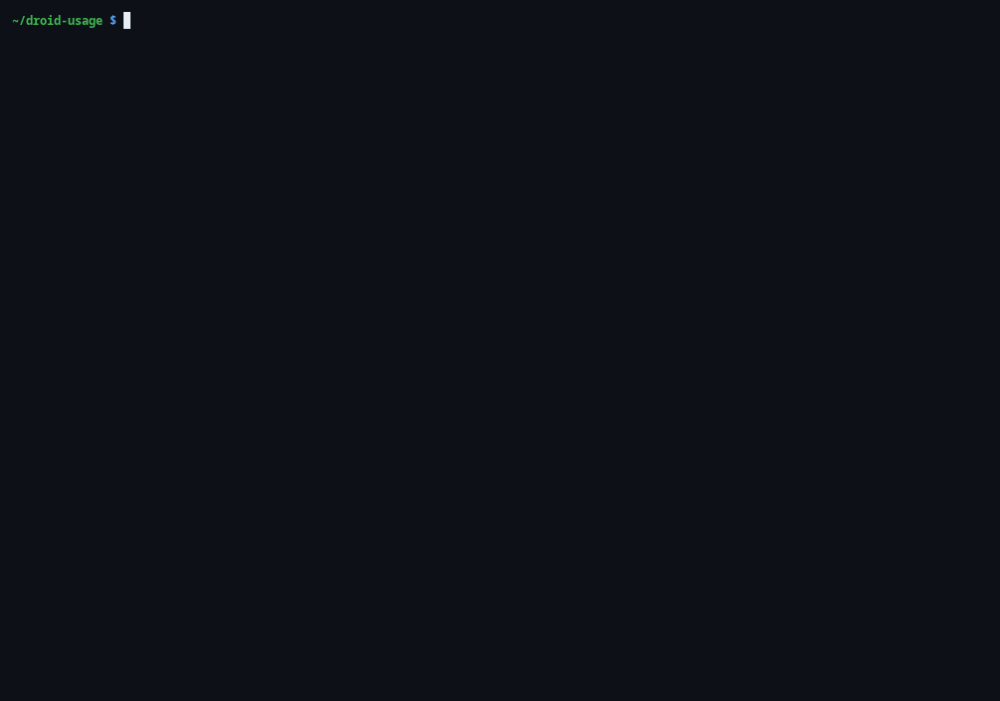

# droid-usage



`droid-usage` prints a usage report for five coding agents, read from their local session logs:

- **Droid**, Factory's CLI (`~/.factory/sessions`)
- **OpenCode** (`~/.local/share/opencode/opencode.db`)
- **Codex CLI** (`~/.codex/sessions` and `~/.codex/archived_sessions`)
- **Pi** (`~/.pi/agent/sessions`)
- **agy**, the Antigravity CLI (`~/.gemini/antigravity-cli`)

The report shows totals by source, a weekly trend, cost and tokens per model, and the top projects. The demo above runs `droid-usage --offline` on the anonymized fixtures in `tests/golden/home`.

## Run

```sh
cargo build --release
target/release/droid-usage            # refreshes saved prices if they are over 24 hours old
target/release/droid-usage --offline  # uses the saved prices only, no network
```

Saved price and multiplier snapshots live in `~/.local/share/droid-usage/`. A refresh downloads two public files and nothing else:

- Multipliers: `https://docs.factory.com/models.md`
- List prices: `https://raw.githubusercontent.com/BerriAI/litellm/main/model_prices_and_context_window.json`

Nothing is uploaded. The program reads local files, and it makes those two GET requests only during a refresh.

## How cost is estimated

- **Droid** sessions use the list price from the LiteLLM table, times the multiplier on Factory's models page.
- **OpenCode** and **agy** sessions use the cost recorded in the session when there is one. Otherwise they use the LiteLLM price.
- **Codex CLI** sessions use the LiteLLM list price as an estimate, not subscription charges. Cached input is counted separately; reasoning is already included in output. A session that switches models uses its latest model. Custom `CODEX_HOME` directories are not read.
- **Pi** sessions sum usage across message, usage, compaction, and branch-summary entries (including branched or compacted history), and use the positive cost recorded in the session when there is one; otherwise they use the LiteLLM price. Reasoning is already included in output. A session that switches models uses its latest model. Custom `PI_CODING_AGENT_DIR` and `PI_CODING_AGENT_SESSION_DIR` directories are not read.
- A session with an unknown model counts toward tokens but not cost. The report says how many sessions this affects.

## Development

```sh
cargo test
```

## Security

To report a vulnerability, see [SECURITY.md](SECURITY.md).

## License

MIT. See [LICENSE](LICENSE).
